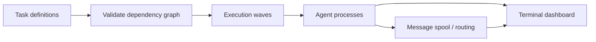

# Developer tooling — experimental agent orchestration in Rust

[← Back to profile](../README.md)

**My role:** built an experimental task-orchestration layer and terminal workflow in a personal fork of Codex CLI.

**Stack:** Rust · dependency graphs · process coordination · terminal UI

**[Read the implementation and taskflow documentation →](https://github.com/ZachEsenbock/codex/tree/sub-agents-rebase/codex-rs/taskflow)**

## The experiment

I explored how a terminal-based coding workflow could coordinate tasks with explicit dependencies, agent processes, and routed messages.

Tasks are parsed into a dependency graph, checked for missing references and cycles, and organized into deterministic execution waves. A terminal dashboard exposes the plan, run history, and communication between agents.

## Implementation focus

- Validation for duplicate tasks, missing dependencies, and cycles.
- Predictable dependency ordering and dry-run planning.
- Process coordination, message routing, and persisted message spools.
- Terminal views for plans and runs.
- Tests for parsing, graph behavior, configuration merging, and planning.

## Scope

This is an experimental extension of an existing open-source tool. The linked branch contains my orchestration work; the underlying Codex CLI comes from OpenAI. It is not a claim of upstream adoption, current-release compatibility, or model-development work.
