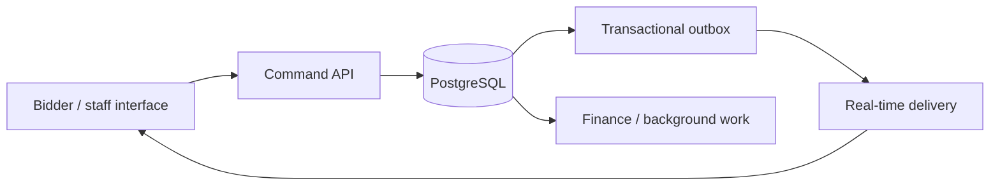

# GatorBid — building an auction marketplace from scratch

[← Back to profile](../README.md)

**My role:** architecture and implementation across the marketplace, staff tools, API, data layer, and background processing.

**Stack:** Next.js · React · TypeScript · NestJS · PostgreSQL · Prisma · Redis

## The product

I built GatorBid from scratch to support timed and webcast auctions. The work spans catalog discovery, bidder registration, live bidding, staff-operated auction rings, payment readiness, invoices, settlements, and auction-data migration.

An auction platform has several views of the same event: the bidder's screen, the clerk's controls, the database, and the finance workflow. Keeping those views consistent is a central engineering problem.

## Decisions that matter

- **Server-owned bid state.** Timed closes, max bids, soft-close rules, and clerk commands resolve against backend state. Reconnecting clients recover from that state.
- **Recorded command outcomes.** Retried commands can replay their recorded result. Reusing an idempotency key with different content is rejected.
- **Transactional real-time events.** Bid outcomes and outbox events are recorded within the transaction boundary, so notification delivery follows the committed result.
- **Shorter financial lock windows.** I moved external tax-quote work outside finance locks and worked on reducing bid-admission contention.
- **Tests around difficult boundaries.** The implementation includes bidding, concurrency, payment, and browser-workflow tests.

## What this demonstrates

Product ownership across a substantial full-stack application, with close attention to concurrency, recovery, and the operational tools staff need. This case study describes implementation work; it makes no claim about production transaction volume or revenue.
