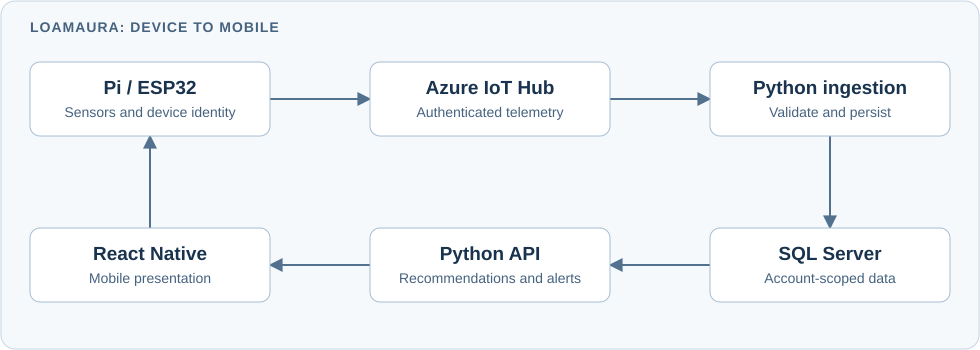

# LoamAura — connected devices, cloud services, and a mobile product

[← Back to profile](../README.md)

**My role:** built the product from scratch across the mobile application, API, event ingestion, and device software.

**Stack:** React Native · TypeScript · Python · Azure IoT Hub · SQL Server · Raspberry Pi · ESP32

## The product

LoamAura connects garden-monitoring devices to a mobile application. It brings together device setup, account ownership, soil telemetry, plant status, recommendations, and alerts.

The work crosses four codebases, with explicit ownership of each step:

## Decisions that matter

- **Account-owned devices.** Device identity and account ownership are checked at the API and ingestion boundaries; telemetry cannot choose its own owner.
- **One owner for recommendations.** The API makes recommendation and planner decisions. The mobile app presents those results, including freshness and unknown states.
- **Authenticated provisioning.** Local setup requires authorization rather than trusting whichever client reaches the device.
- **Checked firmware delivery.** ESP32 update handling validates the allowed HTTPS host and artifact digest before activation.
- **Separate device lifecycles.** Pi container maintenance and ESP32 firmware updates have different mechanisms and are treated accordingly.

## What this demonstrates

End-to-end engineering across user interfaces, cloud APIs, asynchronous processing, and embedded devices. The project includes tests at the API, event-ingestion, and device boundaries. This case study does not claim scientific validation of recommendations or a particular installed device count.
